<p align="center">
  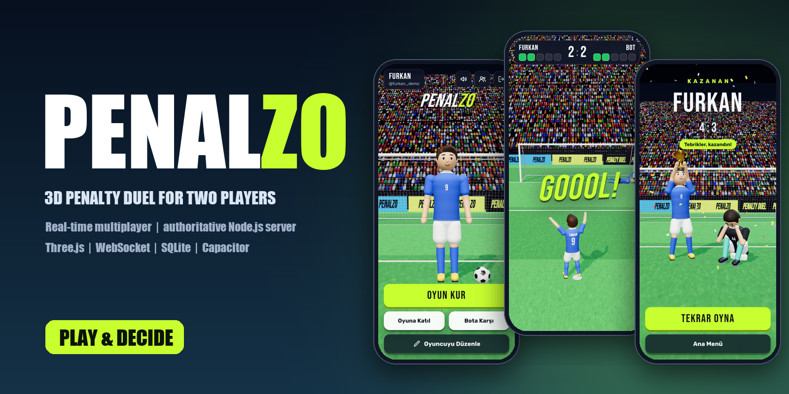
</p>

<p align="center">
  <b>A real-time 3D penalty shoot-out you play with a friend to settle any argument.</b><br/>
  Mobile-first (Android / iOS / browser) &middot; authoritative Node.js server &middot; Three.js
</p>

<p align="center">
  
  
  
  
  
</p>

> Turkish version: [README.tr.md](README.tr.md)

## What is it?

Friends who can't agree on what to do usually flip a coin or play rock-paper-scissors.
**Penalzo** replaces that with a penalty duel: one player shoots, the other keeps goal, then they swap - five kicks each.
Both players secretly pick one of three zones (left / middle / right) within 5 seconds. Same zone = save, different zone = goal.
It is a game of nerve and mind-reading, and it is intentionally simple.

## Demo

<table>
  <tr>
    <td align="center">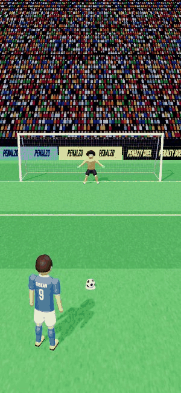<br/><sub>Goal in the top corner</sub></td>
    <td align="center">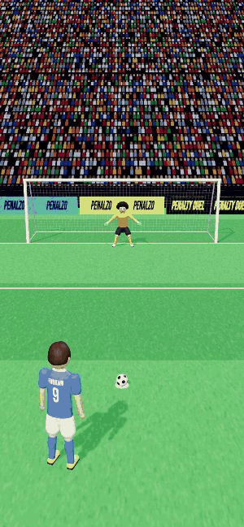<br/><sub>Keeper dives and saves</sub></td>
    <td align="center">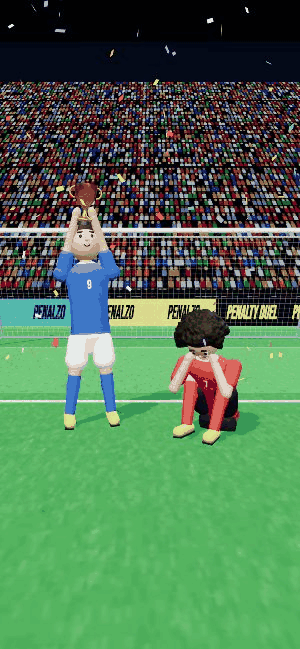<br/><sub>Winner lifts the trophy, loser cries</sub></td>
  </tr>
</table>

<table>
  <tr>
    <td align="center">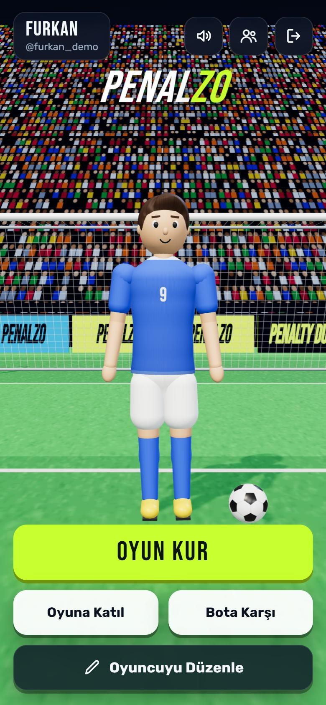<br/><sub>Main menu</sub></td>
    <td align="center">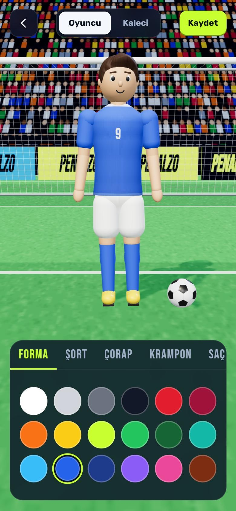<br/><sub>Kit editor</sub></td>
    <td align="center">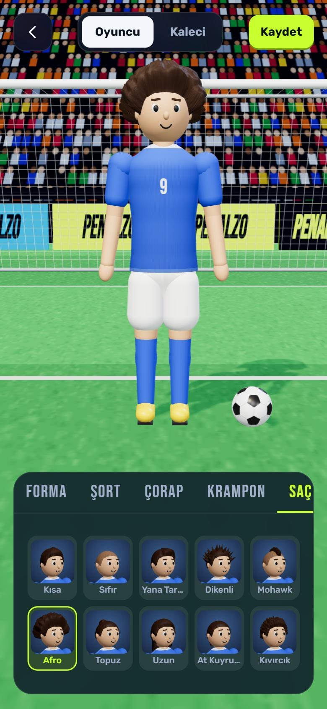<br/><sub>10 hair styles</sub></td>
    <td align="center">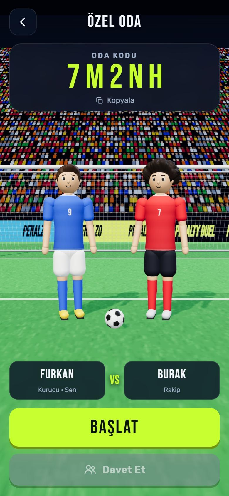<br/><sub>Private room</sub></td>
    <td align="center">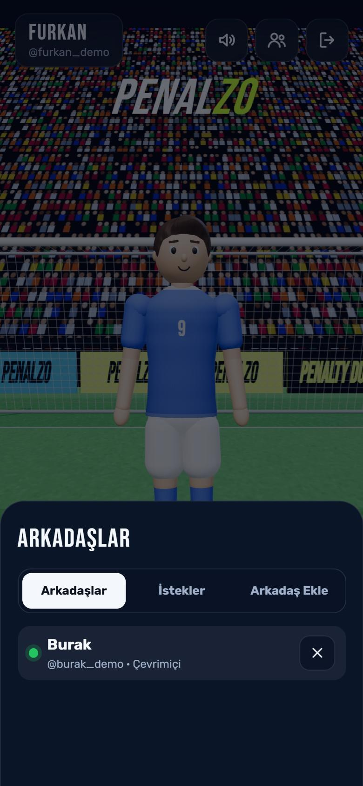<br/><sub>Friends &amp; presence</sub></td>
  </tr>
  <tr>
    <td align="center">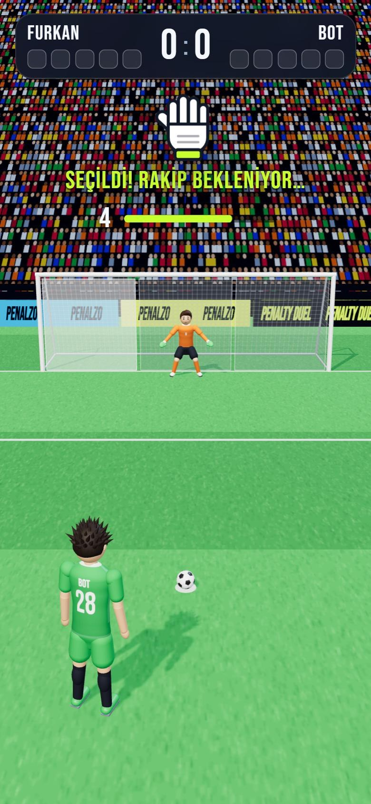<br/><sub>Keeper picks a zone</sub></td>
    <td align="center">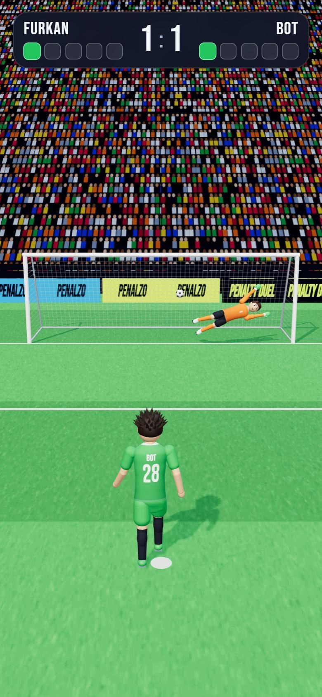<br/><sub>Dive</sub></td>
    <td align="center">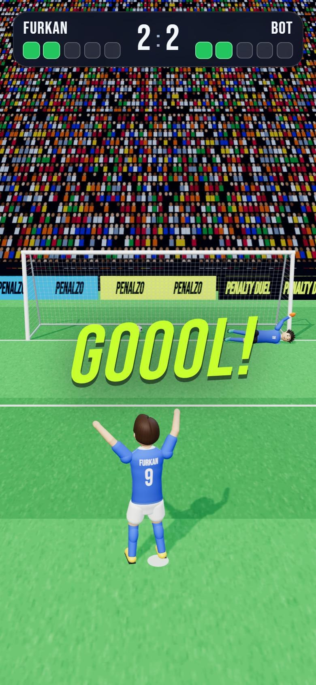<br/><sub>Goal</sub></td>
    <td align="center">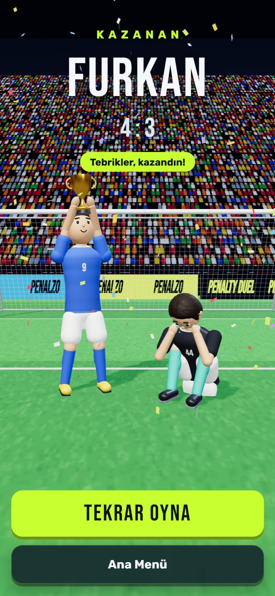<br/><sub>Result screen</sub></td>
    <td></td>
  </tr>
</table>

The in-game UI is currently in Turkish.

## Features

- **Duel rules** - 5 kicks each, alternating. Ends as soon as the result is mathematically decided; a tie goes to sudden death (one kick each until someone leads).
- **Multiplayer** - private rooms with a 5-character code, or invite a friend straight from your friends list (accept / decline pop-up).
- **Accounts** - register / log in, or play as a guest (guests cannot add friends or invite).
- **Friends** - friend requests, accept / decline, live online and in-game status.
- **Practice mode** - play against a bot with a random kit.
- **Character editor** - shirt, shorts, socks, boots, goalkeeper gloves, 10 hair styles + hair colour, shirt number 1-99 (numeric keypad on phones). The shirt back shows your in-game name and number.
- **Everything is generated in code** - characters, hair, stadium, crowd, ball, trophy, all animation (procedural pose blending), textures (canvas) and sound (Web Audio). There are no 3D model, texture or audio files in the repo.

## Backend (the interesting part)

A single Node.js process serves the REST endpoints, the WebSocket game protocol and the built client.

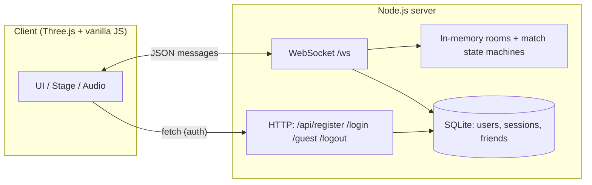

### The server is authoritative

Clients only ever send *intent* (which zone they picked). The server decides everything else:

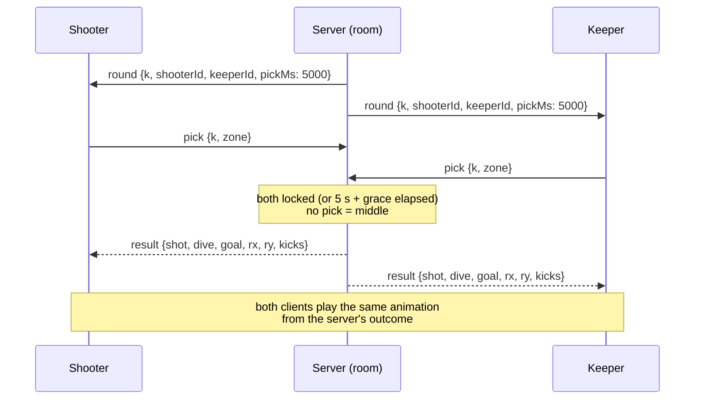

- A pick is never forwarded to the opponent before the round resolves; the picker only gets a private acknowledgement.
- The round index is part of every `pick`, a player can pick once per round, and zones are validated (`-1 | 0 | 1`).
- The server also generates the random ball target (`rx`, `ry`) so both screens render an identical shot.
- Match flow is an explicit state machine per room:

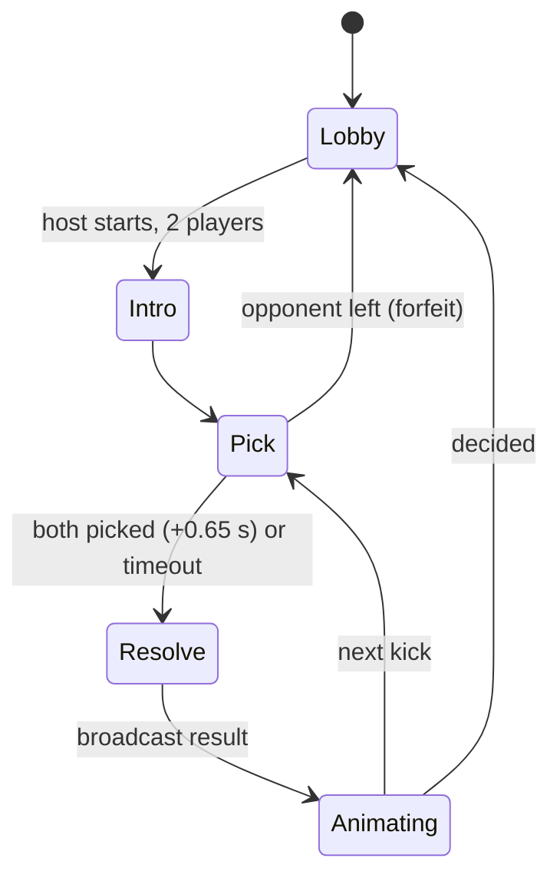

### Protocol

| Direction | Messages |
|---|---|
| Client -> server | `auth` `setName` `setLook` `createRoom` `joinRoom` `leaveRoom` `start` `pick` `practice` `invite` `inviteDecline` `friendAdd` `friendRespond` `friendRemove` |
| Server -> client | `me` `friends` `room` `roomLeft` `matchStart` `round` `picked` `result` `matchEnd` `invited` `info` `error` `kicked` `authFail` |
| HTTP | `POST /api/register` `/login` `/guest` `/logout` |

### Security and robustness

- Passwords hashed with **scrypt** and a per-user salt, compared in constant time.
- Session tokens are 256-bit random values; **only their SHA-256 hash is stored**.
- One active session per account (a new login kicks the old connection).
- Room codes come from a CSPRNG over an unambiguous 32-character alphabet.
- All input is validated server-side: username / display-name patterns, hex colours, number and hair ranges (the look schema in `shared/look.js` is shared by client and server), 16 KB WebSocket payload cap.
- Per-IP rate limiting on the auth endpoints; heartbeat ping every 20 s terminates dead sockets.
- Leaving a running match forfeits it to the opponent; presence changes are pushed to friends.

### Tests

`npm test` runs an end-to-end script (28 assertions) against a running server with real WebSocket clients: registration and login validation, duplicate / wrong credentials, friend request flow and presence, room creation, invite delivery, guest restrictions, full-room rejection, and a complete match checking the goal rule, "no pick = middle", alternating shooters, that the match ends *exactly* when the result is decided (and goes to sudden death on a tie), forfeit on leave, and presence after disconnect.

### Known limitations (honest list)

- Rooms and running matches live in memory: a server restart drops live games (accounts and friends are persisted). One node only; scaling out would need shared room state (e.g. Redis) or sticky routing.
- No reconnect grace period yet: a dropped connection during a match currently forfeits it.
- No per-message rate limit on the WebSocket, and the HTTP limiter reads `X-Forwarded-For`, so it expects to run behind a reverse proxy.
- No push notifications, password reset, or in-app account deletion yet.
- Tested with the automated suite and in a desktop browser (mobile viewport). The Android debug build compiles, but I have not verified it on a physical device yet.

## Run it locally

Requires **Node.js 22.13+** (uses the built-in `node:sqlite`).

```bash
npm install
npm run server   # API + WebSocket on http://localhost:3000
npm run client   # game on http://localhost:5173 (proxies to the server)
```

Open the game in two tabs to play against yourself - the second tab as `http://localhost:5173/?p=2` keeps a separate login.

```bash
npm test         # end-to-end server test (~1.5 min), server must be running
```

### Production

```bash
npm run build    # bundles the client into dist/
PORT=3000 npm start
```

The server then serves the game and the API on one port. Put a TLS-terminating reverse proxy in front (Caddy shown; WebSockets work out of the box):

```
penalzo.example.com {
  reverse_proxy localhost:3000
}
```

Environment: `PORT` (default 3000), `DATA_DIR` (SQLite location, default `./data`).

### Mobile (Capacitor)

The native shell loads the bundled client, so the server address is baked in at build time:

```bash
echo "VITE_SERVER_URL=https://penalzo.example.com" > .env.production
npm run android   # build, sync, open Android Studio
npm run ios       # macOS only (run `npx cap add ios` first)
```

Release builds expect an HTTPS/WSS server. To try a debug build against a plain-HTTP server on your LAN, temporarily add `"server": { "androidScheme": "http", "cleartext": true }` to `capacitor.config.json` and `android:usesCleartextTraffic="true"` to the `<application>` tag of `AndroidManifest.xml` - never ship that.

## Project structure

```
server/   index.js (HTTP + WebSocket + match engine), db.js (SQLite, auth, friends)
shared/   look.js (character schema + validation used by both sides)
client/   src/main.js (UI + flow), net.js, audio.js
          src/three/ stage.js, character.js, hair.js, anim.js, env.js, thumbs.js
scripts/  e2e.mjs
android/  Capacitor Android project
docs/     banner and screenshots used in this README
```

## How it was built

Designed and directed by [Furkan Eroğlu](https://github.com/furkan-eroglu), implemented in pair-programming with [Claude Code](https://claude.com/claude-code).
