<p align="center">
  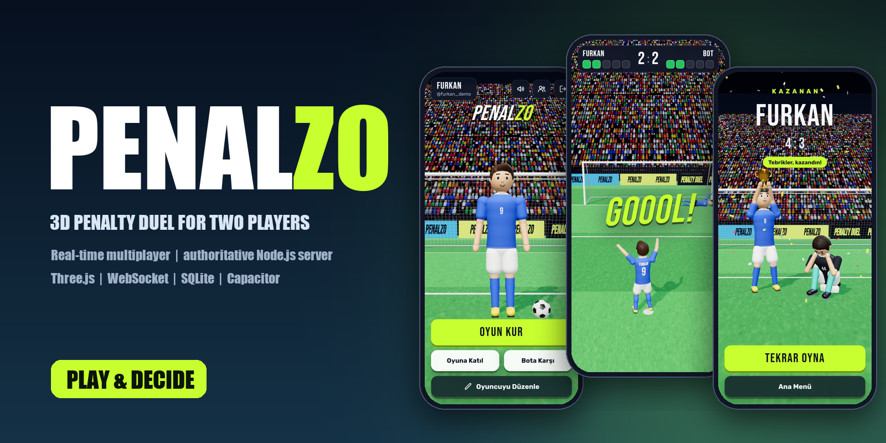
</p>

<p align="center">
  <b>Arkadaşların birlikte karar vermesi için gerçek zamanlı 3D penaltı oyunu.</b><br/>
  Mobil öncelikli (Android / iOS / tarayıcı) &middot; yetkili Node.js sunucusu &middot; Three.js
</p>

> English version: [README.md](README.md)

## Nedir?

Arkadaşlar karar veremediğinde yazı-tura atar ya da taş-kağıt-makas oynar. **Penalzo** bunun yerine penaltı düellosu oynatır:
biri şut çeker, diğeri kaleye geçer, sonra roller değişir; ikisi de 5'er atış yapar.
Her iki oyuncu da 5 saniye içinde kalenin üç bölgesinden birini (sol / orta / sağ) gizlice seçer.
Aynı bölge = kurtarış, farklı bölge = gol. Kurallar bilinçli olarak sade tutulmuştur.

## Görüntüler

<table>
  <tr>
    <td align="center">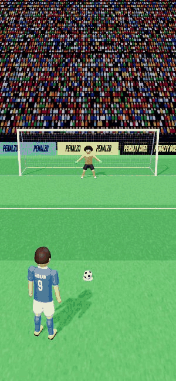</td>
    <td align="center">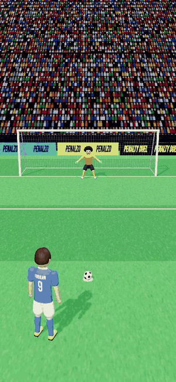</td>
    <td align="center">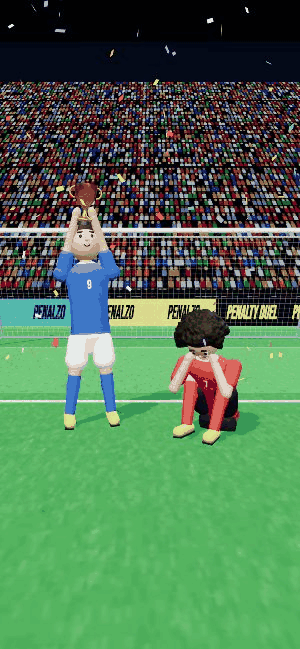</td>
  </tr>
</table>

<table>
  <tr>
    <td>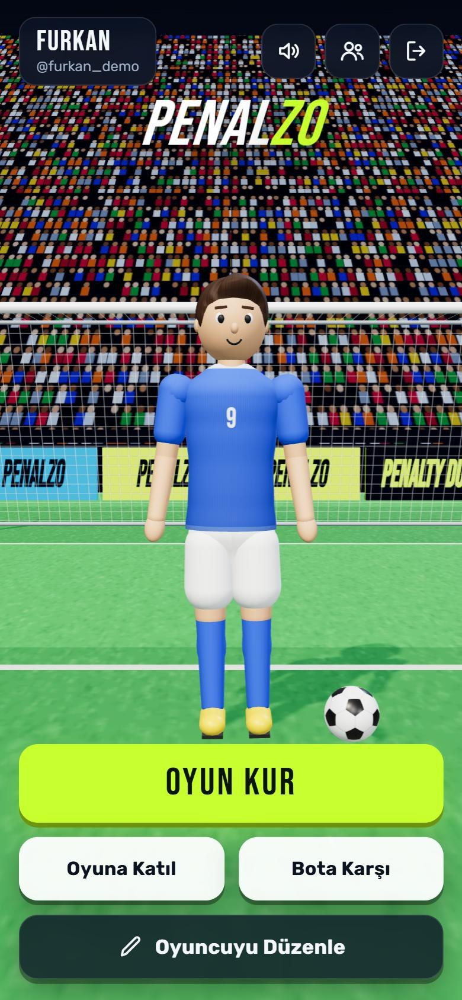</td>
    <td>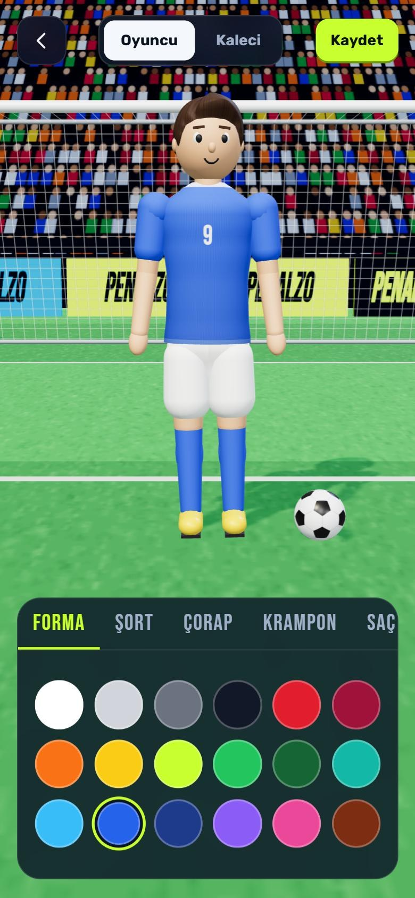</td>
    <td>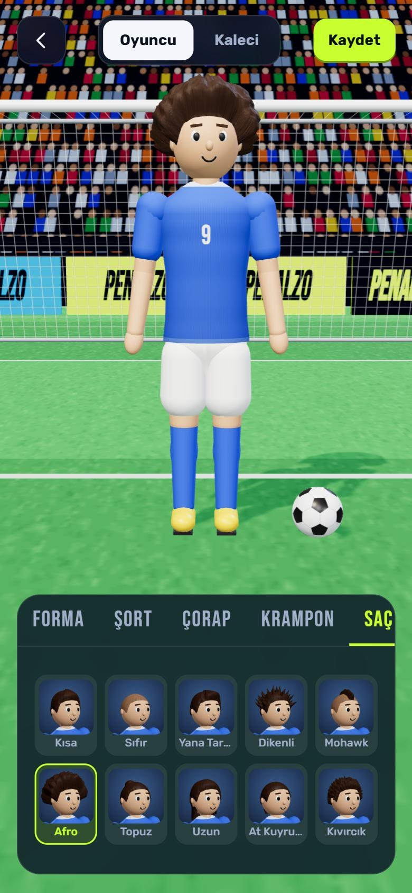</td>
    <td>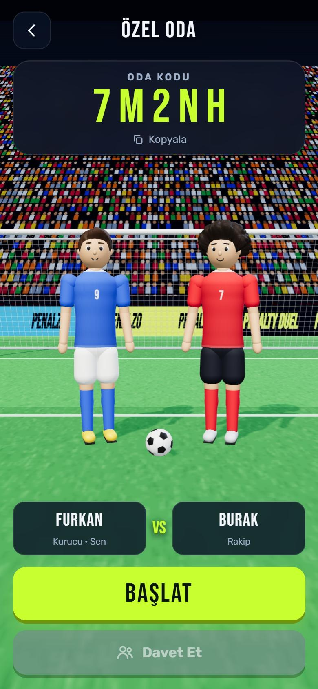</td>
    <td>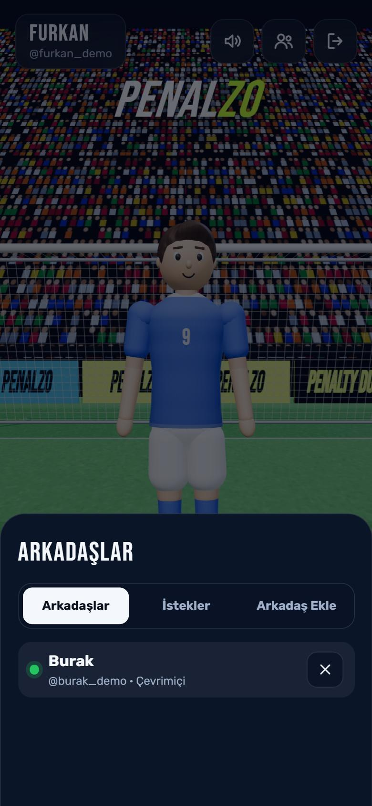</td>
  </tr>
  <tr>
    <td>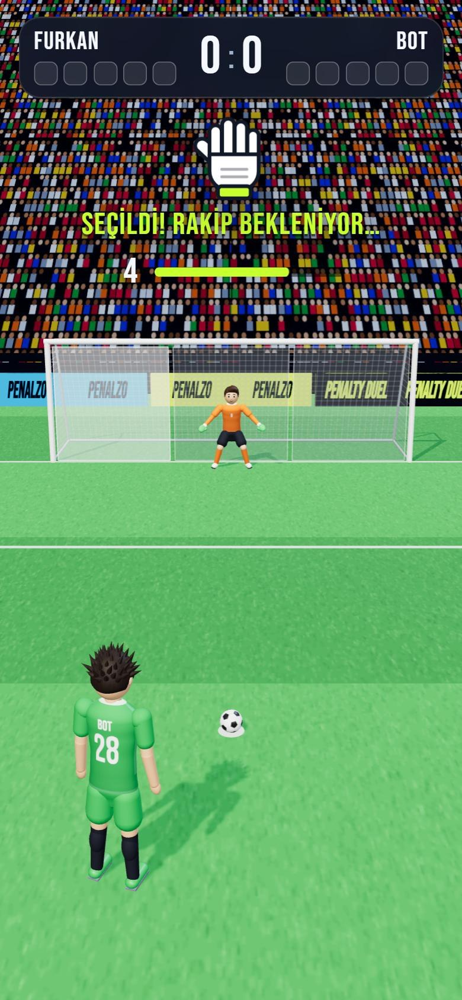</td>
    <td>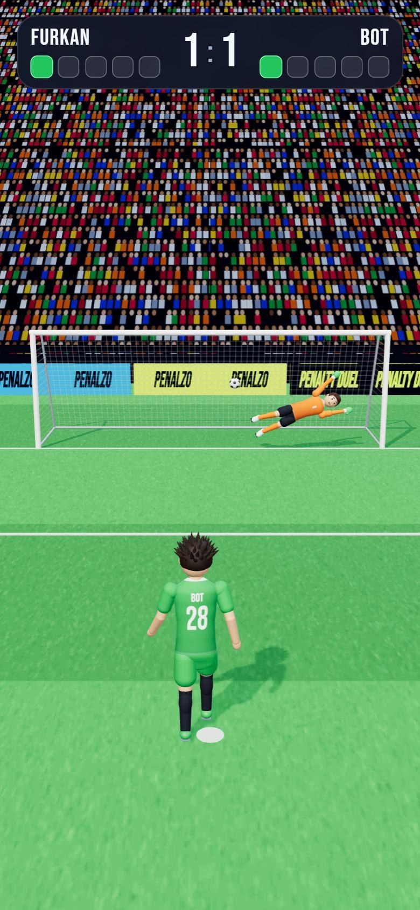</td>
    <td>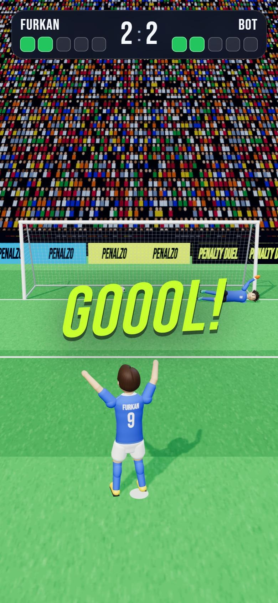</td>
    <td>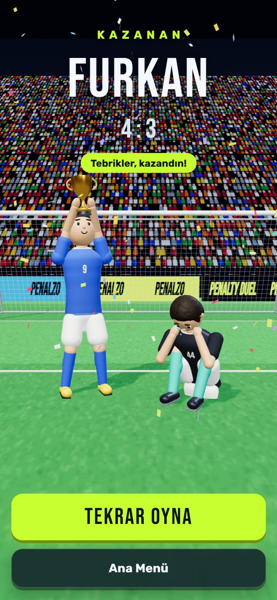</td>
    <td></td>
  </tr>
</table>

## İndir (Android)

[**Releases**](https://github.com/furkan-eroglu/penalzo/releases) bölümündeki `Penalzo-v0.1.0-offline.apk` dosyasını kurup hemen oynayabilirsin.

- **Çevrimdışı sürüm:** bota karşı oynama ve oyuncu düzenleme sunucusuz çalışır. Çok oyunculu mod (oda, arkadaş, davet) yayında bir sunucu gerektirir, bu sürüm sunucuya bağlanmaz.
- **Debug imzalı:** Android, bilinmeyen kaynaklardan kuruluma izin vermeni isteyecek.
- Gerçek bir Android telefonda ve Android 17 emülatöründe (API 37) denendi: açılış, menü, düzenleyici ve dokunmayla oynanan tam bir maç.

## Özellikler

- **Kurallar:** 5'er atış, sırayla. Sonuç matematiksel olarak kesinleştiği anda maç biter; beraberlikte birer birer seri penaltı oynanır.
- **Çok oyunculu:** 5 karakterlik oda koduyla özel oda ya da arkadaş listesinden doğrudan davet (kabul / reddet bildirimi).
- **Hesaplar:** kayıt ol / giriş yap ya da misafir olarak oyna (misafir arkadaş ekleyemez, davet edemez).
- **Arkadaşlar:** istek gönderme, kabul / reddet, çevrimiçi ve oyunda durumu.
- **Antrenman:** rastgele takımlı bota karşı oyna. Tamamen cihazda çalışır, sunucu gerekmez; çok oyunculu sunucuyla aynı kural modülünü (`shared/rules.js`) kullanır.
- **Oyuncu düzenleme:** forma, şort, çorap, krampon, kaleci eldiveni, 10 saç stili ve saç rengi, 1-99 forma numarası. Formanın sırtında oyun içi adın ve numaran yazar.
- **Her şey kodla üretilir:** karakterler, saçlar, stadyum, seyirci, top, kupa, animasyonlar, dokular ve sesler. Depoda hazır 3D model, doku ya da ses dosyası yoktur.

## Sunucu mimarisi

Tek bir Node.js süreci REST uçlarını, WebSocket oyun protokolünü ve derlenmiş istemciyi sunar. Hesaplar, oturumlar ve arkadaşlıklar SQLite'ta, odalar ve çalışan maçlar bellekte tutulur.

- **Sunucu yetkilidir:** istemciler sadece niyetlerini (hangi bölgeyi seçtikleri) gönderir. Gol / kurtarış kararını, rastgele top hedefini ve maçın bitişini sunucu verir; iki ekran aynı sonucu oynatır.
- Bir seçim, tur sonuçlanmadan rakibe asla iletilmez. Tur numarası her `pick` mesajında doğrulanır, oyuncu tur başına bir kez seçebilir.
- Şifreler **scrypt** ve kullanıcıya özel tuzla saklanır; oturum anahtarlarının yalnızca SHA-256 özeti veritabanına yazılır. Tüm girdiler sunucuda doğrulanır (görünüm şeması `shared/look.js` ile istemciyle ortaktır).
- Maç sırasında odadan ayrılan oyuncu hükmen yenilir; çevrimiçi durum değişiklikleri arkadaşlara anlık iletilir.
- `npm test`: gerçek WebSocket istemcileriyle 28 doğrulamalık uçtan uca test (kayıt, arkadaşlık, davet, oda, maç kuralları, erken bitiş, seri penaltı, hükmen galibiyet).
- `npm run test:unit`: sunucusuz birim testleri. Erken bitiş kuralı, olası tüm atış dizileri denenerek (kaba kuvvet) doğrulanır; çevrimdışı antrenman motoru protokole göre oynatılıp kontrol edilir.

Ayrıntılı protokol, durum makinesi diyagramları ve **bilinen sınırlamalar** için [İngilizce README](README.md#backend) bölümüne bakın.

## Çalıştırma

Node.js 22.13+ gerekir.

```bash
npm install
npm run server   # http://localhost:3000
npm run client   # http://localhost:5173
```

Canlı kurulum ve mobil derleme adımları için [README.md](README.md) dosyasına bakın.

## Nasıl yapıldı?

Tasarım ve yönlendirme [Furkan Eroğlu](https://github.com/furkan-eroglu) tarafından, geliştirme [Claude Code](https://claude.com/claude-code) ile birlikte (eşli programlama) yapıldı.
